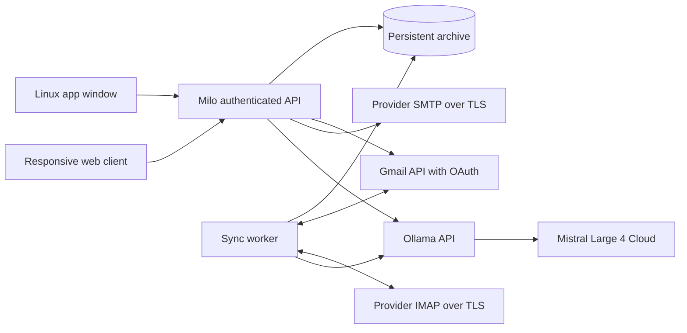

# Architecture

## The invariant

Adding an account on Linux must not require adding it again on iOS. One private
Milo service is authoritative for account credentials, imported mail, categories,
AI results, filters, snooze and drafts. Clients hold only session cookies and
rendered state. The service must stay reachable for other devices to use it.

## Current implementation

Python/FastAPI provides a same-origin API and static client. SQLite runs in WAL
mode; threads share one connection behind a reentrant lock. Fernet encrypts
provider passwords, OAuth client credentials and Google refresh tokens, using a host-side key. Sessions store only token hashes.
The installed owner client authorizes first-start setup automatically through
a private, one-time link. It exchanges the immediately removed URL fragment for
a short-lived HttpOnly/SameSite=Strict cookie scoped to setup. The cookie is
Secure in production and survives a reload. The visible form asks only for the
owner's Milo password. Public visitors cannot initialize or claim the archive;
successful password setup consumes the authorization and removes the cookie.

For generic IMAP, the archive key is `(account, folder, UIDVALIDITY, UID)`, never a sequence number.
A UIDVALIDITY reset invalidates local identities and queued operations before
importing the current folder. Sync fetches without marking mail as read. User
flags enter a durable queue; incoming provider flags cannot overwrite pending
user changes. An account lock serializes provider sync and generic IMAP edits/moves. Gmail
local edits use short database critical sections while network sync continues;
each new queued edit gets its own ID, so an older acknowledgement cannot remove
a newer operation. Archive moves preserve
AI metadata through Message-ID while the destination receives a new UID.

The worker imports up to 200 new messages per folder per pass, newest first,
then backfills older mail. It currently scans the UID/flags set rather than using
CONDSTORE/QRESYNC or IDLE. Inbox queries return the most recent 500 messages;
the archive continues to backfill beyond that UI limit. General custom folders,
large mailbox pagination and provider-specific labels need further work.

Google mail uses `(account, Gmail message ID)` and retains thread IDs and label
IDs. Gmail sync imports 100 messages per pass and uses paginated `history.list`
for changes; cursors advance only after a complete page is saved. A history 404
starts a full scan while retaining the old cache until scanning completes.
Read/star/archive operations modify native labels. Draft/trash/spam messages
are excluded from client lists and automatic AI analysis. Custom label browsing
and mailbox UI pagination remain future work.

Google authorization uses the official Python library, PKCE and one-time state
stored encrypted for ten minutes. A separate HttpOnly/SameSite=Lax cookie binds
the browser returning from Google; the original Milo session must still be
valid. The main session remains Strict. Refreshes persist in the vault and
cannot overwrite newer reconnect credentials. Google sending uses Gmail API,
retaining the canonical message ID and thread ID without a second local copy.
Access logs strip query strings so OAuth codes are not logged by Milo. The
external HTTPS proxy must also avoid logging callback query strings.

Sent mail is cached locally after SMTP acknowledgement. The generic adapter
does not append a second copy into a provider's Sent folder because some
providers already save it; a matching imported Sent Message-ID replaces the
local copy. Exactly-once SMTP delivery cannot be guaranteed after a connection
failure. Milo retains the draft on error, explains ambiguity and never retries
automatically. Forwarding currently forwards the text, not original attachments.

AI receives bounded message text with a fixed untrusted-input instruction and a
JSON schema in the system prompt. Local models also receive the native schema
parameter; Ollama Cloud does not support that enforcement, so cloud answers are
parsed and validated locally. It can classify categories, summarize and draft, without mailbox
mutation tools. User-defined deterministic filters take precedence. Automatic
analysis processes up to 10 unanalyzed messages per account per sync pass and
retries remaining messages on later passes. Cloud processing requires consent.

## Linux

`scripts/launch.py` starts a detached loopback service and opens a Chromium app
window. `install.py` adds a user-local launcher. This is a web-rendered Linux
client, not a Qt/Tauri binary. Service logs and the archive live in `.data/live`;
closing the window keeps synchronization alive until the service exits. The
service currently needs restarting after reboot; a user service/package comes
later. Only run one service process against a given archive.

## Deployment and iOS

The next deployment milestone is an always-on service behind HTTPS, reachable
from Linux and a physical iPhone. Prefer a private network/VPN and a reverse
proxy to a loopback listener. Bind remotely only with a firewall and TLS proxy.
Enable `--secure-cookies` when using HTTPS. The proxy must preserve Host and
Origin for same-origin checks. Do not expose the demo on a shared/public host.

PWA manifest and responsive navigation establish a portable UI, not a verified
iOS product. Native iOS will use the same API and archive, with Keychain-backed
device credentials, local encrypted cache, background delivery and APNs. No
second IMAP configuration is introduced by that client. Offline clients need a
versioned change feed, acknowledgements and conflict policy; the current shared
service design does not yet implement replicated offline databases.

## Trust and open work

This is a single-owner service, not a multi-tenant SaaS. The host can read the
mail database and decrypt provider credentials. It is not end-to-end encrypted
across devices. TLS verifies provider certificates. Message HTML is sanitized
with nh3, preserving tables and safe inline styles, then rendered in a sandboxed
iframe with scripts, forms and external resources disabled. CID images use
authenticated attachment endpoints; HTTPS remote images require a user action.
Cookies are HttpOnly/SameSite; cross-origin writes are rejected. Client assets
use a restrictive CSP and bundled fonts; email scripts are never executable.

Conversation lists return only metadata, grouped by account and provider thread
ID. IMAP uses References/In-Reply-To roots. The reader includes received and sent
messages; opening a Google thread fetches missing messages in the background.
Pin and theme preferences stay on the shared service. Trash is a local tombstone
plus a durable provider operation, retaining identity and retries across restarts.

Future work includes session/device revocation UI, account removal,
passphrase recovery, encrypted backup, Microsoft OAuth, operational supervision, full mailbox pagination, incoming attachment
size negotiation and concurrency/load validation. Account names and pause/resume settings are shared. The account management UI
updates encrypted IMAP credentials and offers Google reconnection bound to the
existing email address. Pausing prevents later sync passes and automatic AI
work; an already-running provider request/pass can finish. Cached mail, drafts
and queued edits remain available. Account deletion/revocation still needs a
separate explicit maintenance flow. These limitations must remain visible until implemented and tested.
