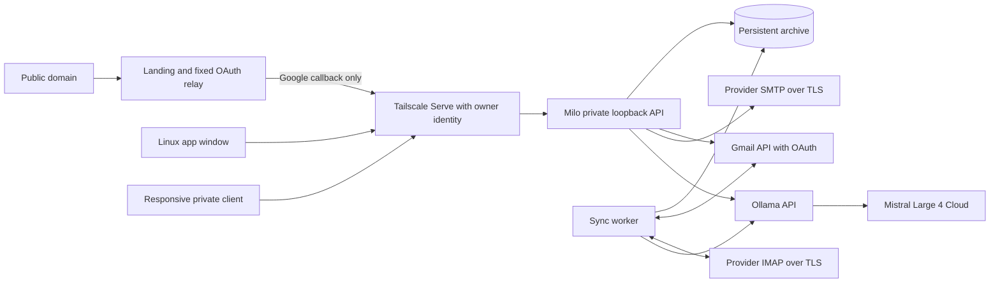

# Architecture

## The invariant

Adding an account on Linux must not require adding it again on iOS. One private
Milo service is authoritative for account credentials, imported mail, categories,
AI results, filters, snooze and drafts. Clients hold session cookies, rendered state and a local recovery copy of pending
draft edits. Received mail and provider credentials stay on the server. The service must stay reachable for other devices to use it.

## Current implementation

Python/FastAPI provides a same-origin API and static client. SQLite runs in WAL
mode; threads share one connection behind a reentrant lock. Fernet encrypts
provider passwords, OAuth client credentials and Google refresh tokens, using a host-side key. Sessions store only token hashes.
The permanent Mac deployment separates the public landing on loopback port 8025
from the archive backend on loopback port 8029. The backend accepts the exact
owner identities from its private configuration, using Tailscale Serve's
attested identity headers. Unknown identities receive 404 even with a valid
Milo cookie. Password and setup endpoints are unavailable in this mode. The
loopback binding and disabled forwarded-IP trust are required to prevent direct
network clients from supplying trusted identity headers. Standalone local
password onboarding remains available for development outside this deployment.

For generic IMAP, the archive key is `(account, folder, UIDVALIDITY, UID)`, never a sequence number.
A UIDVALIDITY reset invalidates local identities and queued operations before
importing the current folder. Sync fetches without marking mail as read. User
flags enter a durable queue; incoming provider flags cannot overwrite pending
user changes. An account lock serializes provider sync and generic IMAP edits/moves. Gmail
local edits use short database critical sections while network sync continues;
each new queued edit gets its own ID, so an older acknowledgement cannot remove
a newer operation. Archive moves preserve
AI metadata through Message-ID while the destination receives a new UID.

The worker imports up to 200 new messages per folder per pass, newest first,
then backfills older mail. It currently scans the UID/flags set rather than using
CONDSTORE/QRESYNC or IDLE. Inbox queries return metadata for the most recent 100 conversations;
the archive continues to backfill beyond that UI limit. General custom folders,
large mailbox pagination and provider-specific labels need further work.

Google mail uses `(account, Gmail message ID)` and retains thread IDs and label
IDs. Gmail sync imports 100 messages per pass and uses paginated `history.list`
for changes; cursors advance only after a complete page is saved. A history 404
starts a full scan while retaining the old cache until scanning completes.
Read/star/archive operations modify native labels. Draft/trash/spam messages
are excluded from client lists and automatic AI analysis. Custom label browsing
and mailbox UI pagination remain future work.

Google authorization uses the official Python library, PKCE and one-time state
stored encrypted for ten minutes. A separate HttpOnly/SameSite=Lax cookie binds
the browser returning from Google; the original Milo session must still be
valid. The main session remains Strict. Refreshes persist in the vault and
cannot overwrite newer reconnect credentials. Google sending uses Gmail API,
retaining the canonical message ID and thread ID without a second local copy.
Access logs strip query strings so OAuth codes are not logged by Milo. The
external HTTPS proxy must also avoid logging callback query strings.

Sent mail is cached locally after SMTP acknowledgement. The generic adapter
does not append a second copy into a provider's Sent folder because some
providers already save it; a matching imported Sent Message-ID replaces the
local copy. Exactly-once SMTP delivery cannot be guaranteed after a connection
failure. Milo retains the draft on error, explains ambiguity and never retries
automatically. Forwarding currently forwards the text, not original attachments.

AI receives bounded message text with a fixed untrusted-input instruction and a
JSON schema in the system prompt. Local models also receive the native schema
parameter; Ollama Cloud does not support that enforcement, so cloud answers are
parsed and validated locally. It can classify categories, summarize and draft, without mailbox
mutation tools. User-defined deterministic filters take precedence. Automatic
analysis processes up to 10 unanalyzed messages per account per sync pass and
retries remaining messages on later passes. Cloud processing requires consent.

## Linux

The installed Omarchy launcher opens a dedicated Chromium app window connected
only to the verified private Mac service. The client executes on the laptop;
its encrypted IndexedDB cache, downloaded bodies and pending operations persist
there. The Mac owns provider synchronization, credentials and the authoritative
archive. Local loopback/demo servers remain isolated development modes.

## Deployment and iOS

The permanent Grog supervisor runs the public presentation and private archive
as separate processes. Tailscale Serve routes private HTTPS to the owner-protected
loopback backend. The registered Google redirect stays public; a fixed relay
returns the browser to the private callback, where PKCE, state and nonce are
validated. See [deployment](DEPLOYMENT.md). Physical iPhone validation remains a
separate milestone.

PWA manifest and responsive navigation establish a portable UI, not a verified
iOS product. Native iOS will use the same API and archive, with Keychain-backed
device credentials, local encrypted cache, background delivery and APNs. No
second IMAP configuration is introduced by that client. The shared client now retains downloaded mail and binary assets in an encrypted
IndexedDB cache and queues offline metadata/trash edits. Thread indices are
separate from immutable versioned bodies, and metadata refreshes do not download
old content again. Native iOS must implement persistent local storage and the
same offline behavior; see [the required cache contract](CLIENT_CACHE.md). The normalized local catalogue uses a paged metadata snapshot and verifies missing
threads before removing them. A dedicated worker indexes downloaded bodies for
local word search. Idempotent edits and safe preferences enter a serialized local
journal in both online and offline modes; background HTTP acknowledgement cannot
overwrite a newer local intent. An incremental change feed and native device
cache remain future work.

## Trust and open work

This is a single-owner service, not a multi-tenant SaaS. The host can read the
mail database and decrypt provider credentials. It is not end-to-end encrypted
across devices. TLS verifies provider certificates. Message HTML is sanitized
with nh3, preserving tables and safe inline styles, then rendered in a sandboxed
iframe with collapsed quoted history and intrinsic-height resizing. Scripts, forms and external resources disabled. CID images use
authenticated attachment endpoints; HTTPS remote images require a user action.
Cookies are HttpOnly/SameSite; cross-origin writes are rejected. Client assets
use a restrictive CSP and bundled fonts; email scripts are never executable.

Conversation lists return only metadata, grouped by account and provider thread
ID. IMAP uses References/In-Reply-To roots. The reader includes received and sent
messages; opening a Google thread fetches missing messages in the background.
Pin and theme preferences stay on the shared service. Trash is a local tombstone
plus a durable provider operation, retaining identity and retries across restarts.

Future work includes session/device revocation UI, account removal,
passphrase recovery, encrypted backup, Microsoft OAuth, operational supervision, full mailbox pagination, incoming attachment
size negotiation and broader provider concurrency/load validation. Account names and pause/resume settings are shared. The account management UI
updates encrypted IMAP credentials and offers Google reconnection bound to the
existing email address. Pausing prevents later sync passes and automatic AI
work; an already-running provider request/pass can finish. Cached mail, drafts
and queued edits remain available. Account deletion/revocation still needs a
separate explicit maintenance flow. These limitations must remain visible until implemented and tested.

## Identity and recap lifecycle

A validated server setting contains the editable owner name, aliases, role/context
and reply language. Connected account addresses are supplied separately, without
provider secrets. AI receives this identity and a trusted current UTC timestamp.
Reply generation receives a bounded recent thread with explicit owner/other-author
roles and the target incoming message; analysis/recap UI language is separate
from the language used for the draft.

A dedicated background recap worker coalesces new-mail notifications and checks
bounded inbox sources. Its fingerprint includes recent incoming/sent content,
identity, model and UTC day; unchanged snapshots are reused. It persists the
result and generated time, retries failures with backoff and preserves the last
valid result. GET/POST `/api/recap` read that snapshot and never invoke the model.
The worker is separate from synchronization and HTTP request handling, so model
latency does not block the inbox or provider receipt. Consent is checked before
cloud generation, and shutdown waits for active storage users before closing
SQLite.

The Docker service publishes only host loopback ports. Tailscale's attested owner
header is accepted only from loopback or the explicitly configured dedicated
Docker gateway, with forwarded-client-IP processing disabled. The container has
no mailbox credentials in its image and keeps the existing host archive as its
only persistent bind mount.

Reply composers fetch authenticated recipient metadata separately through
`/api/messages/{id}/recipients`, reading bounded MIME headers instead of a complete
body. This includes Reply-To, To and Cc and is cached on the device; a large quoted
message no longer blocks opening a reply editor. AI composition uses this same
recipient selection and preserves user edits while generation continues.
